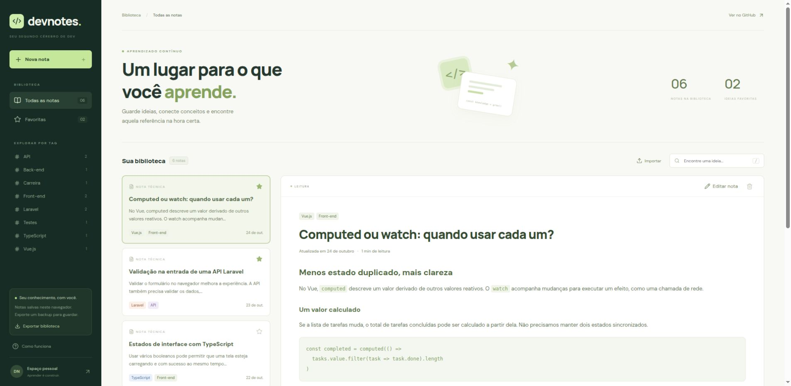

# DevNotes

**Um lugar para o que você aprende.**

Biblioteca pessoal de notas técnicas em Markdown, construída com **Next.js, React e TypeScript**. Organize aprendizados por tags, encontre referências e mantenha um backup transportável.



## Funcionalidades

- Criar e editar notas em Markdown com pré-visualização.
- Buscar por título, conteúdo e tags, sem depender de acentos.
- Combinar tags e favoritos para encontrar referências.
- Salvar a biblioteca no navegador, com formato de dados versionado.
- Exportar backup JSON e importar combinando notas pela data de atualização.
- Validar o formato, tamanho e identificadores do arquivo importado antes de alterar a biblioteca.
- Usar pelo teclado, com busca pelo atalho `/`, estados de foco e ajuda em diálogo nativo.
- Explorar seis notas iniciais de exemplo, com referências para documentação técnica.

## Executar

Requer Node.js 22+ e npm.

```sh
npm ci
npm run dev
```

Abra [localhost:3000](http://localhost:3000). Para usar outra porta:

```sh
npm run dev -- --port 3002
```

## Build e testes

```sh
npm test
npm run build
npm start
```

Os testes de domínio verificam busca combinada, favoritos, tags, contagem, validação e mesclagem dos backups. O workflow em `.github/workflows/ci.yml` executa os testes e o build em pushes e pull requests.

## Organização do código

| Caminho                         | Responsabilidade                            |
| ------------------------------- | ------------------------------------------- |
| `src/app`                       | Página, metadados e estilos responsivos     |
| `src/components/Library.tsx`    | Biblioteca, filtros, seleção e persistência |
| `src/components/NoteEditor.tsx` | Formulário e pré-visualização Markdown      |
| `src/lib/notes.ts`              | Busca, validação, contagem e importação     |
| `src/lib/seed.ts`               | Conteúdo inicial demonstrativo              |
| `tests/notes.test.ts`           | Contratos das regras de domínio             |

## Decisões

**Persistência local:** o projeto funciona sem conta ou API. A leitura do armazenamento ocorre após a montagem para manter a renderização inicial compatível com o Next.js. Alterações só são aplicadas ao estado após a gravação local ter sucesso.

**Importação sem substituição cega:** backups válidos são combinados por identificador. Uma nota importada só substitui outra se for mais recente. Há limites de 1 MB por arquivo e 500 notas na biblioteca.

**Markdown:** `react-markdown` renderiza o conteúdo sem habilitar HTML bruto. Links externos abrem com `noopener noreferrer`.

**Estado derivado:** resultados de busca e contadores são calculados a partir das notas, evitando manter cópias sincronizadas em efeitos.

## Limites atuais

Os dados pertencem ao navegador e à origem em que o aplicativo foi aberto. Não há sincronização entre dispositivos, autenticação ou banco remoto. Limpar os dados do site remove a biblioteca local; use o backup JSON para transportá-la. A edição ainda não possui salvamento automático ou histórico de versões.

## Estudar e evoluir

Veja [o roteiro de estudo](docs/ESTUDO.md). Próximas melhorias possíveis: detecção de alterações não salvas, salvamento automático, histórico de versões e uma API para sincronização.

Projeto de portfólio desenvolvido com apoio de IA, revisão e testes. Os textos iniciais são exemplos de estudo e não representam publicações anteriores do autor.

**Davi Novakoski** · [GitHub](https://github.com/davinovakoski11) · [LinkedIn](https://www.linkedin.com/in/davi-novakoski-78874a447/)
